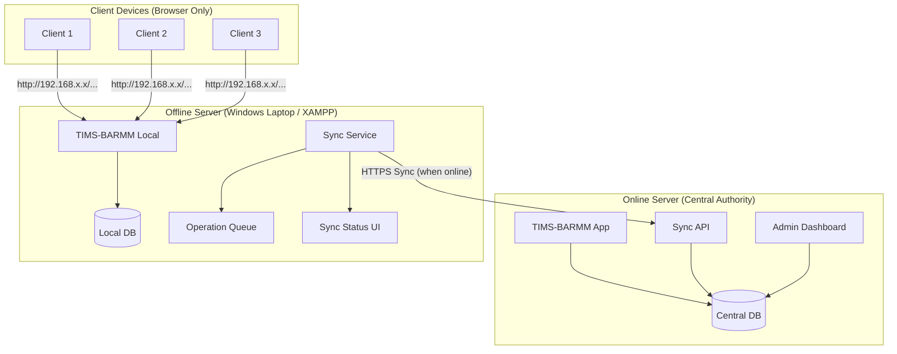
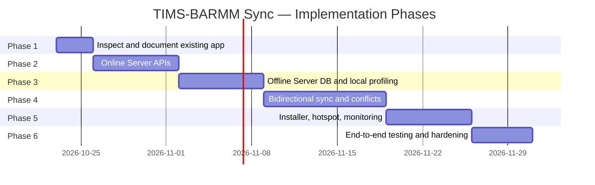

# TIMS-BARMM: Online–Offline Server Synchronization System
> **Implementation Plan** — Structured reference for phased development.  
> Source: `offline and online implementation plan.txt`  
> Last updated: 2026-10-22

---

## Table of Contents

1. [Project Objective](#1-project-objective)
2. [Pre-Implementation Audit](#2-pre-implementation-audit)
3. [System Architecture](#3-system-architecture)
4. [Online Server Implementation](#4-online-server-implementation)
5. [Offline Server Implementation](#5-offline-server-implementation)
6. [Laptop Hotspot & LAN Support](#6-laptop-hotspot--lan-support)
7. [Conflict & Duplicate Resolution](#7-conflict--duplicate-resolution)
8. [Installer & Deployment](#8-installer--deployment)
9. [Security & Data Protection](#9-security--data-protection)
10. [Testing Requirements](#10-testing-requirements)
11. [Implementation Order (Phases)](#11-implementation-order-phases)
12. [Definition of Done](#12-definition-of-done)
13. [Final Deliverables](#13-final-deliverables)

---

## 1. Project Objective

Extend the existing **TIMS-BARMM** Laravel application into a **centralized online–offline beneficiary profiling system** that supports three environments:

| Environment | Description |
|---|---|
| **Online Server** | Central, authoritative TIMS-BARMM installation and database |
| **Offline Server** | Windows laptop (XAMPP) running a local TIMS-BARMM. Serves client devices via hotspot/LAN. Syncs to Online Server when internet is available |
| **Client Devices** | Laptops/computers accessing the Offline Server via browser — no local installation required |

> [!IMPORTANT]
> Implement **both** Online and Offline components — APIs, database changes, sync workflows, install/config, security, and UIs. Do **not** implement only the offline server.

---

## 2. Pre-Implementation Audit

Before modifying any code, inspect the existing application at `http://localhost/TIMS-BARMM/public/`:

- [ ] Identify PHP framework, Laravel version, and application architecture
- [ ] Inspect beneficiary, batch, Excel import, ID card, reporting, authentication, and audit-log implementations
- [ ] Inspect existing database schema — primary keys, foreign keys, relationships
- [ ] Identify current online deployment configuration and database
- [ ] Determine how beneficiary records and batches are created and updated
- [ ] Identify existing validation rules, duplicate detection, and authorization policies
- [ ] Determine which features can be reused by the offline installation

> [!WARNING]
> Preserve the existing application and database. Do **not** create a replacement system or rewrite working functionality unnecessarily.

---

## 3. System Architecture

---

### A. Online Server — Central Authority

**Responsibilities:**
- Host the existing TIMS-BARMM application and central beneficiary database
- Provide a **secure synchronization API** (HTTPS only)
- Register, authorize, and revoke Offline Servers
- Serve initial dataset downloads and synchronization checkpoints
- Handle incremental changes, conflict management, and central duplicate detection
- Monitor sync history, Offline Server health, and application compatibility

> [!NOTE]
> The Online Server must remain **fully usable** by regular online users while Offline Servers are connected or disconnected. Never expose the central database directly to Offline Servers.

---

### B. Offline Server — Local Profiling Hub

**Runs on:** One designated Windows laptop with XAMPP (or compatible PHP/DB runtime)

**Components:**
- Local TIMS-BARMM installation
- Own local database
- Synchronization service
- Durable queue of pending changes
- Local duplicate detection
- Local user/session management
- Local audit logging and automated backups

**Key rule:** Must continue functioning when the internet is **disconnected**.  
Serves multiple client devices over Wi-Fi hotspot, LAN, or Ethernet.

> [!CAUTION]
> All connected clients **share** this local database. They must **not** maintain separate databases or independently sync with the Online Server.

---

### C. Client Devices — Browser Access

Clients access the Offline Server at the server's local network address, e.g.:  
`http://192.168.137.1/TIMS-BARMM/public/`

**Requirements:**
- Standard web browser only — no XAMPP, no local database, no installation package
- Individual authentication and role-based access
- Immediate local validation and duplicate warnings
- Sync/conflict notifications visible in the UI
- Works as long as the local server and LAN are available

---

## 4. Online Server Implementation

### A. Offline Server Registration

Create an admin interface to register and manage Offline Servers.

Each registered server record must store:

| Field | Description |
|---|---|
| `server_id` | Globally unique identifier |
| `name` | Human-readable name |
| `location` | Assigned office or profiling location |
| `registered_at` | Registration timestamp |
| `last_seen_at` | Last contact timestamp |
| `app_version` | Offline app version |
| `schema_version` | DB schema version |
| `authorization_status` | `active` / `revoked` / `pending` |
| `last_synced_at` | Last successful sync timestamp |
| `sync_status` | Pending uploads, errors, health |

> Use **secure, revocable credentials** per server. Do not embed permanent production secrets in installer files.

---

### B. Secure Synchronization API

Implement authenticated API endpoints covering:

| Endpoint Purpose | Method |
|---|---|
| Register or activate an Offline Server | `POST` |
| Request an authorized initial dataset | `GET` |
| Download changes since a checkpoint | `GET` |
| Upload pending offline changes | `POST` |
| Acknowledge processed operations | `POST` |
| Retrieve server-side validation results | `GET` |
| Retrieve duplicate warnings and conflicts | `GET` |
| Resolve conflicts (authorized users) | `POST` |
| Retrieve application compatibility info | `GET` |
| Report synchronization health/errors | `POST` |

**API rules:**
- Validate every request, enforce authorization
- Reject unsupported client versions
- Use the existing Laravel routing, auth, and validation conventions

---

### C. Initial Data Download

After registration, the Offline Server requests an authorized initial dataset:

1. Authenticate the Offline Server
2. Verify authorization and assigned data scope
3. Establish a consistent data snapshot
4. Download beneficiary records, reference tables, and relevant batch info
5. Include stable record identifiers and revision metadata
6. Support **pagination or resumable downloads** for large datasets
7. Verify completeness and internal consistency
8. Record a synchronization checkpoint
9. Activate offline profiling only after successful initialization

> [!NOTE]
> Do not download the entire central database. Scope downloads to the assigned profiling location.

---

### D. Incremental Synchronization Protocol

The Online Server must maintain a reliable change history for delta syncs.

**Protocol rules:**
- Process uploads and downloads as identifiable operations with stable IDs and **idempotency keys**
- Avoid applying the same operation twice
- Support retries and interrupted connections
- Acknowledge operations individually or in verifiable batches
- Advance checkpoints only after changes are safely processed
- Preserve failed operations for retry/review
- Record an auditable synchronization history

> [!CAUTION]
> Never assume an HTTP 200 response alone proves every record in a batch was processed correctly.

---

### E. Central Duplicate Detection

Validate incoming records against the central database:

| Outcome | Handling |
|---|---|
| Exact duplicate / existing record | Reject or flag |
| Potential duplicate (needs review) | Return structured result for human review |
| Conflicting update to existing record | Preserve both, return conflict result |
| New valid record | Accept and insert |

> Never auto-merge distinct beneficiary records based solely on similar names.

---

### F. Online Administration Dashboard

Authorized administrators can monitor:
- Registered Offline Servers (name, location, status)
- Last successful synchronization per server
- App and schema compatibility versions
- Pending uploads and downloads
- Failed sync operations
- Duplicate warnings and unresolved conflicts
- Device revocation and access controls

---

## 5. Offline Server Implementation

### A. Local Database Schema

Compatible with the Online Server's beneficiary/batch structures where practical.

**Added synchronization metadata columns:**

| Column | Purpose |
|---|---|
| `global_uuid` | Globally unique record ID (avoids auto-increment collisions) |
| `revision` | Record revision number |
| `server_revision` | Last-known server revision |
| `local_change_status` | `pending` / `synced` / `conflict` |
| `operation_id` | Operation queue reference |
| `sync_checkpoint` | Last sync checkpoint |
| `conflict_status` | `none` / `pending_review` / `resolved` |
| `deleted_at` (tombstone) | Soft-delete marker for sync propagation |
| `sync_audit` | Sync audit metadata |

> [!WARNING]
> Do **not** rely exclusively on auto-incrementing numeric IDs across independent databases. Use UUIDs for global identity.

---

### B. Local Profiling (Offline Capability)

When internet is disconnected, users can still:
- Browse existing beneficiary records (downloaded dataset)
- Create and edit profiles
- Run supported validations
- Manage permitted batches
- Generate ID cards using local templates
- View locally available reports
- Review duplicate warnings against local records

**Rules:**
- All changes persist in the local database before being reported as saved
- Every change requiring central sync must be recorded in the **durable operation queue**

---

### C. Local Duplicate Detection

- Run duplicate checks against the local database immediately on create/edit
- Use appropriate identifiers and existing business rules
- Present a warning before finalizing a potentially duplicate record
- Allow authorized users to review matching records

> [!NOTE]
> Clearly communicate that local duplicate checks **cannot** identify records created or changed on the Online Server since the last successful synchronization.

---

### D. Local Sync Service

When connectivity is available, the sync service must:

1. Authenticate with the Online Server
2. Verify compatibility and authorization
3. Upload pending local changes
4. Receive server-side validation results
5. Download approved remote changes
6. Record acknowledgments and update checkpoints
7. Display unresolved duplicates and conflicts
8. Retry recoverable failures without duplicating operations

**Retry behavior:**
- Bounded retries with appropriate backoff
- Do not flood the Online Server when connectivity is unavailable
- Never discard unsynchronized local changes because a connection failed

---

### E. Sync Status Interface

A local UI panel showing:

| Indicator | Details |
|---|---|
| Internet connectivity | Connected / Disconnected |
| Central server reachability | Reachable / Unreachable (separate from internet status) |
| Local server status | Running / Error |
| Last successful sync | Timestamp |
| Pending uploads | Count |
| Pending downloads | Count |
| Successful operations | Count |
| Failed operations | Count + details |
| Unresolved duplicates/conflicts | Count + review links |
| Current sync progress | Progress bar / status |
| Error messages | Clear text + recovery instructions |

---

## 6. Laptop Hotspot & LAN Support

The Offline Server must support the Windows laptop acting as a **Wi-Fi hotspot**.

### Requirements

- Display the actual local IP address and application URL
- Provide a **copyable URL** and optional **QR code** for client onboarding
- Explain how to enable the Windows hotspot (built-in feature)
- Configure Apache to accept authorized local-network connections
- Provide Windows Firewall configuration guidance
- Keep database ports (3306) and admin tools inaccessible to client devices
- Detect or allow configuration of changing hotspot IP addresses
- Provide diagnostics for client reachability, Apache availability, and database health
- Warn about or prevent **sleep/hibernate** during active profiling sessions (with admin consent)
- Support switching to a dedicated router or Ethernet LAN without changing the database architecture

> [!TIP]
> Verify that connected devices can communicate with the server under the actual Windows networking configuration — not just in a simulated environment.

---

## 7. Conflict & Duplicate Resolution

Handle **duplicate records** and **conflicting edits** separately.

### Example Scenarios

| Scenario | Type |
|---|---|
| Client creates a beneficiary that already exists centrally | Duplicate |
| Two Offline Servers independently create records for the same person | Duplicate |
| Offline user edits a beneficiary changed centrally after last download | Conflict |
| Remote deletion conflicts with a local edit | Conflict |

### Resolution Process (per case)

1. Preserve existing and incoming information
2. Identify record IDs, revisions, and source server
3. Return a structured conflict/duplicate result
4. Notify the appropriate user
5. Require authorized review where auto-resolution is unsafe
6. Record the decision and audit history

> [!CAUTION]
> Never use unconditional **last-write-wins** behavior for important beneficiary information.

### Review Interface Options

| Action | Description |
|---|---|
| Keep existing | Discard incoming change |
| Accept incoming | Overwrite with incoming change |
| Merge selected fields | Manual field-level merge (where supported) |
| Link to existing | Link incoming entry to verified existing beneficiary |

All resolution actions must be **authorized, validated, and auditable**.

---

## 8. Installer & Deployment

Provide a **versioned Offline Server installer/package** that installs or configures:

- Compatible PHP runtime and database server (XAMPP or equivalent)
- TIMS-BARMM under the appropriate web root
- Local database schema
- Apache configuration for LAN access
- Synchronization service
- Initial server registration and setup wizard
- Firewall guidance and health checks
- Backup and recovery configuration

**Rules:**
- Respect licensing/redistribution of XAMPP and all dependencies
- Provide verified install steps for any dependency that cannot be bundled
- The installer must **not** contain central database passwords, permanent API secrets, or production admin credentials
- Client computers do **not** require this installer
- Provide a separate, safe **update procedure** for upgrading schema and application

---

## 9. Security & Data Protection

Because the system handles **beneficiary personal information**:

| Requirement | Detail |
|---|---|
| HTTPS | All remote synchronization |
| Credentials | Secure, revocable per-server credentials |
| Authentication | Required for all users and servers |
| Authorization | Role-based on all record operations |
| Local storage | Encrypt device where appropriate |
| Session protection | Secure local sessions and config |
| Data scope | Limit downloads to authorized scope only |
| Audit logs | Record changes, sync operations, conflict resolution |
| Backups | Secure and verified restoration |
| Database | No direct remote access to local DB |
| Dev tools | Not exposed to LAN or internet |
| Revocation | Process to revoke lost/compromised Offline Server |

---

## 10. Testing Requirements

Test the **complete end-to-end system**, not only the interface.

### Required Test Scenarios

| # | Scenario | Type |
|---|---|---|
| 1 | Register an Offline Server with the Online Server | Integration |
| 2 | Download and verify an authorized initial dataset | Integration |
| 3 | Connect 2+ clients through the offline hotspot | Network |
| 4 | Create a beneficiary from one client, see it from another | Real-time |
| 5 | Disconnect the internet and continue profiling | Offline |
| 6 | Reconnect and synchronize changes to the Online Server | Sync |
| 7 | Retry an interrupted upload without creating duplicate records | Idempotency |
| 8 | Detect an existing central beneficiary during synchronization | Duplicate |
| 9 | Resolve conflicting edits safely | Conflict |
| 10 | Verify unauthorized servers/users cannot access protected data | Security |
| 11 | Restart the Offline Server and resume pending synchronization | Recovery |
| 12 | Restore the local database from a backup | Backup |
| 13 | Verify schema incompatibility is detected before unsafe sync | Compatibility |

**Also test:** empty datasets, large datasets, partial failures, expired credentials, and duplicate operations.

---

## 11. Implementation Order (Phases)

### Phase 1 — Inspect & Document
- Inspect existing TIMS-BARMM application
- Document current online architecture and database schema
- Identify reusable components
- **Output:** Architecture document, schema map, audit findings

### Phase 2 — Online Server APIs
- Offline Server registration and authorization
- Initial data download endpoints
- Incremental synchronization API
- Central duplicate detection integration
- Admin monitoring dashboard
- **Output:** Documented API endpoints, admin UI, tests

### Phase 3 — Offline Server Foundation
- Local database schema with sync metadata (UUIDs, revisions, queues)
- Local profiling (full CRUD while offline)
- Durable operation queue
- Client LAN access configuration
- Local duplicate detection
- **Output:** Working local installation, client access, tests

### Phase 4 — Bidirectional Synchronization
- Upload/download sync cycle implementation
- Idempotency keys and checkpoint management
- Retry logic with bounded backoff
- Duplicate warning and conflict resolution workflow
- Sync status UI
- **Output:** Complete working sync, conflict resolution UI, tests

### Phase 5 — Installer, Hotspot & Operations
- Versioned Offline Server installer/package
- Windows hotspot configuration, QR code, IP display
- Sync monitoring dashboards (Online and Offline)
- Automated backups and restoration guide
- Schema-safe update procedure
- **Output:** Installer package, ops documentation, deployment guide

### Phase 6 — End-to-End Testing & Hardening
- Run all 13 required test scenarios
- Security audit (auth, data scope, revocation)
- Data-integrity verification
- Performance under large datasets
- **Output:** Test results, known limitations, signed-off deployment

> [!IMPORTANT]
> Complete each phase with working tests before proceeding. Do **not** attempt to implement everything in a single unverified code change.

---

## 12. Definition of Done

The feature is complete **only** when:

- [ ] Online Server can register and authorize an Offline Server
- [ ] Offline Server can download an authorized initial dataset
- [ ] Multiple clients can use the Offline Server via hotspot — no individual installation required
- [ ] Clients can continue profiling without internet access
- [ ] Local changes persist safely and synchronize to Online Server when connectivity returns
- [ ] Duplicate records and conflicting edits are detected and handled safely
- [ ] Failed or interrupted synchronization can resume without losing or duplicating changes
- [ ] Both Online and Offline administrators can monitor relevant sync status
- [ ] Security, backup, recovery, and compatibility checks are implemented
- [ ] **Existing TIMS-BARMM functionality remains fully intact**

---

## 13. Final Deliverables

| # | Deliverable |
|---|---|
| 1 | Summary of existing architecture discovered (Phase 1 audit) |
| 2 | Implementation plan and necessary schema changes |
| 3 | Modified/created files and components |
| 4 | API endpoints and synchronization protocol documentation |
| 5 | Installation and configuration instructions (Online and Offline) |
| 6 | Test results and known limitations |

---

> [!CAUTION]
> **Critical:** Do not implement only the offline laptop or hotspot. Implement the complete **Online Server to Offline Server** relationship, including the secure sync API and **both sides** of the synchronization workflow. The existing Online Server remains the central authority; the Offline Server acts as a local profiling hub for multiple browser-based clients.

---

*Plan source: `offline and online implementation plan.txt` (432 lines, 19,585 bytes) — 2026-10-22*
